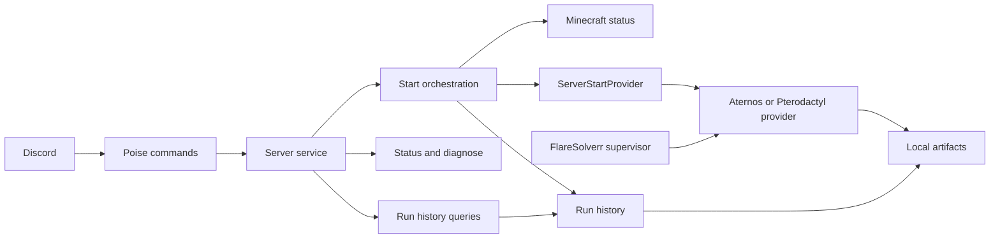

# Butler

[](https://github.com/germagla/butler_rs/actions/workflows/ci.yml)

A Rust Discord bot for starting and checking one configured Minecraft server, with diagnostics for investigating failed or uncertain operations.

The repository is named `butler_rs`, but the product identity is Butler. Butler can start one configured Minecraft server through either Play Hosting's Pterodactyl API or the browser-backed Aternos provider.

## Engineering Overview

- **Provider adapters:** Pterodactyl and Aternos share the server-operation interface while keeping their API and browser workflows separate.
- **Operation coordination:** Cross-process admission locks prevent overlapping provider operations. Cancellation and shutdown retain ownership while verification and cleanup finish.
- **Failure handling:** An uncertain start response is verified against provider and Minecraft state before reporting a result; retry and verification windows are bounded.
- **Diagnostics:** Run history, event logs and optional browser artifacts help investigate failures, with command-access restrictions, redaction and retention controls.
- **Verification:** CI checks dependency advisories, formatting, builds, tests, Clippy and a Docker configuration smoke test.

This version manages a single configured server. The sections below cover setup, architecture and operational limits.

## Current Features

- `/server start` starts the configured server through the current provider adapter.
- `/server status` checks Minecraft reachability and typed status.
- `/server diagnose` reports local bot/server diagnostics.
- `/bot runs` lists recent completed start runs kept in memory.
- `/bot run` shows details for a specific run ID.
- `/bot last-error` shows the most recent failed run.
- Terminal diagnostics for local operation.
- Local screenshots, HTML captures, and JSONL event diagnostics with redaction and retention controls.

## Command Access

| Command | Access |
| --- | --- |
| `/server start` | Public |
| `/server status` | Public |
| `/server diagnose` | Bot owner or guild Administrator |
| `/bot runs` | Bot owner or guild Administrator |
| `/bot run` | Bot owner or guild Administrator |
| `/bot last-error` | Bot owner or guild Administrator |

Bot owners are configured with `BUTLER_OWNER_IDS`. In DMs, restricted commands are owner-only because there is no guild Administrator context. Owners can inspect all run history; guild Administrators can inspect raw run history only for runs from their current guild.

## Architecture



The active start lock is cross-process and global, which is appropriate for the single configured server this version targets. Future multi-server support should key active runs by workspace, guild, or server ID.

`src/server_service/` is split into start orchestration, status/diagnose, run queries, run tracking/artifact retention, response formatting, and shared types.

## Local Setup

1. Install Rust.
2. For Aternos, install Chrome or Chromium. For Pterodactyl on macOS, install OrbStack and configure the isolated `flaresolverr` container described below.
3. Copy `.env.example` to `.env`.
4. Fill in Discord, provider, Minecraft, and owner settings.
5. Run the bot:

```bash
cargo run --release
```

For a live Minecraft status probe without Discord:

```bash
cargo run --bin status_debug -- your-server.example.com:25565
```

For direct provider smoke tests without Discord:

```bash
# Authenticates, reads provider state, and checks Minecraft status without host mutations.
cargo run --release -- --provider-check

# Runs the configured provider start flow. This may wake an allocation and start the server.
cargo run --release -- --provider-start-once
```

These commands may run while the LaunchAgent bot is active. They share Butler's cross-process
provider-admission lock, so provider smoke tests, Discord starts, and Play Hosting status checks
cannot overlap. A six-character
run ID is printed, and diagnostic artifacts follow `ARTIFACT_CAPTURE` under `ARTIFACT_DIR`.
Pterodactyl smoke tests first try the panel directly. Only when Play Hosting presents a fresh
Cloudflare challenge does Butler borrow an already-ready FlareSolverr or temporarily start and
supervise it. A Butler-started container is stopped after clearance is cached. On Ctrl-C or
SIGTERM, Butler retains admission ownership until the current provider result and any required
submission verification finish, performs cleanup, and exits nonzero. After an uncatchable forced
kill, the next bot launch reconciles and stops only the exact container generation recorded as
Butler-owned.

`--provider-check` is read-only with respect to the server host. It does not require
`DISCORD_TOKEN`, issue allocation wake requests, or issue power requests.
`--provider-start-once` runs the default Minecraft preflight, the provider adapter, and the
60-second provider-and-Minecraft fallback for an ambiguous submitted start. It does not exercise
Discord response handling, run-history events, or `wait_online:true`. Successful/skipped commands
return process exit status zero; failed or unverified commands return nonzero. A power POST can
take up to 60 seconds, provider-level ambiguity verification can take another 60 seconds, and the
outer provider/Minecraft fallback can take a final 60 seconds, so an ambiguous power operation may
need about three minutes after allocation completes.

### Start Automatically On macOS

Install Butler as a per-user LaunchAgent so it starts after login and restarts if it exits:

```bash
./scripts/install-launch-agent.sh
```

The installer and Butler share a provider-admission lock under the configured `ARTIFACT_DIR`.
The installer refuses to unload an already-running Butler process while a provider start or Play
Hosting status check is active, and Butler rejects new provider operations while installation owns
the lock. Wait for the active operation to finish, then run the installer again. A separate process
lock prevents two Butler instances from running against the same artifact directory. The
LaunchAgent plist requests a longer graceful-shutdown window, but current macOS reports an
effective 60-second exit timeout. Exact-generation ownership markers and startup reconciliation
provide cleanup recovery if macOS terminates Butler before an on-demand container can stop.

The installer builds the release binary, restricts `.env` to owner-only access, and runs the binary with the repository as its working directory. Re-run the installer after code changes to rebuild and restart the service.

Validate `.env` without connecting to Discord or starting local runtime services:

```bash
cargo run --release -- --check-config
```

Do not also run `cargo run --release` while the LaunchAgent is loaded, because that starts a second bot process. For an interactive run, unload the service first, then re-run the installer when finished:

```bash
launchctl bootout gui/$(id -u)/com.germagla.butler-rs
cargo run --release
```

Inspect the service and logs:

```bash
launchctl print gui/$(id -u)/com.germagla.butler-rs
tail -f artifacts/launchd/stdout.log artifacts/launchd/stderr.log
```

Remove automatic startup without deleting logs or run artifacts:

```bash
./scripts/uninstall-launch-agent.sh
```

## Configuration

| Variable | Purpose | Default |
| --- | --- | --- |
| `DISCORD_TOKEN` | Discord bot token. | Required |
| `SERVER_PROVIDER` | Active provider: `pterodactyl` or `aternos`. | Required |
| `MINECRAFT_SERVER_ADDR` | Minecraft address used by status, diagnose, and start preflight. | `localhost:25565` |
| `PTERODACTYL_PANEL_URL` | HTTPS panel origin. | Required for Pterodactyl |
| `PTERODACTYL_SERVER_ID` | Pterodactyl server identifier. | Required for Pterodactyl |
| `PTERODACTYL_API_TOKEN` | Pterodactyl client API token. | Required for Pterodactyl |
| `PTERODACTYL_POWER_ENABLED` | Allow the provider to issue the start power action. | `false` |
| `PTERODACTYL_ALLOCATION_WAIT_SECS` | Initial wait for Play Hosting allocation. Healthy queued/waking progress may continue to the hard cap. Valid range: 1-3600 seconds. | `1200` |
| `PTERODACTYL_ALLOCATION_MAX_WAIT_SECS` | Hard cap for an extended healthy allocation wait. Must be at least the initial wait and no more than 3600 seconds. | `3600` |
| `FLARESOLVERR_URL` | Loopback-only FlareSolverr endpoint. | `http://127.0.0.1:8191/` |
| `FLARESOLVERR_CONTAINER` | Existing isolated Docker container Butler supervises. | `flaresolverr` |
| `ORBSTACK_BIN` | Optional OrbStack CLI override. | `/opt/homebrew/bin/orbctl` |
| `DOCKER_BIN` | Optional Docker CLI override. | `/usr/local/bin/docker` |
| `ATERNOS_USER` / `ATERNOS_PASS` | Browser credentials. | Required for Aternos |
| `ATERNOS_SERVER_ID` | Optional Aternos server selector. | Empty |
| `HEADLESS` / `CHROME` | Aternos browser settings. | `true` / auto-detect |
| `START_WAIT_ONLINE_SECS` | Max wait for Minecraft to become playable, both for `/server start wait_online:true` and automatic background verification after an accepted Play Hosting start. Valid range: 1-3600 seconds. | `600` |
| `RUN_HISTORY_LIMIT` | Completed runs retained in memory and newest artifact run directories retained locally. | `20` |
| `ARTIFACT_DIR` | Local diagnostics directory. | `artifacts/runs` |
| `ARTIFACT_CAPTURE` | Artifact capture policy: `screenshots`, `full`, `failure`, or `off`. | `screenshots` |
| `BUTLER_ATTACH_SCREENSHOTS` | Attach saved browser screenshots when available. This applies to Aternos; Pterodactyl responses are text-only. | `true` |
| `BUTLER_OWNER_IDS` | Comma-separated Discord user IDs authorized for restricted commands. Invalid non-numeric IDs fail startup. | Empty |
| `BUTLER_PERSIST_RUN_EVENTS` | Write step-level JSONL diagnostics under `ARTIFACT_DIR`. | `true` |
| `BUTLER_REDACT_RUN_EVENTS` | Redact Discord IDs and names in persisted JSONL events. | `true` |
| `BUTLER_LOG` | Tracing/debug verbosity: `off`, `error`, `warn`, `info`, `debug`, `trace`. | `info` |
| `BUTLER_COLOR` | Enable colored terminal output unless `NO_COLOR` or `TERM=dumb` disables it. | `true` |

Invalid boolean, numeric, owner ID, artifact capture, log level, and color values fail startup instead of falling back silently.

### FlareSolverr Lifecycle

In Pterodactyl mode, Butler does not start FlareSolverr with the bot. Normal API requests first use the cached Cloudflare clearance, so most provider work has no browser-container overhead. When Play Hosting requests a fresh browser challenge, Butler starts OrbStack if necessary, starts `flaresolverr`, verifies its loopback readiness endpoint, obtains and caches clearance, waits a short cleanup grace period, and stops the container before continuing through the potentially long allocation queue.

If FlareSolverr was already running, Butler borrows it and never stops it. A local owner-only JSON marker records both the container ID and Docker start timestamp, preventing a manually restarted container from being mistaken for a Butler-owned process. Immediately before a start or restart, an interim intent marker records the previous container generation. Butler promotes it only after Docker inspection records the exact new generation; if that inspection never completes, startup leaves the container untouched and logs that manual reconciliation is required. Cancellation drops the operation runtime into the supervisor cleanup path. Butler never stops OrbStack because that would interrupt unrelated containers.

The expected media-stack configuration keeps FlareSolverr behind its own Compose profile, uses restart policy `no`, pins the image by digest, binds host port `8191` only to `127.0.0.1`, and preserves the internal `http://flaresolverr:8191/` endpoint for Prowlarr. Butler validates these properties before starting the configured container and restarts it after a bounded readiness failure. Docker and OrbStack child processes receive a minimal environment without Butler or provider secrets. The API token is sent only by Butler to the exact configured HTTPS panel origin; FlareSolverr receives no API credentials.

With on-demand mode, Prowlarr or another shared integration can use FlareSolverr only while the
container happens to be running. Start it manually when those integrations need an always-on
instance; Butler will detect that externally started instance, borrow it when challenged, and
leave it running.

For Play Hosting servers in limbo, Butler checks the host's sleep status and uses the wake endpoint with the full UUID only when allocation is not already active. It initially waits up to `PTERODACTYL_ALLOCATION_WAIT_SECS` for an active allocation. If Play Hosting is still returning a valid, unblocked `queued` or `waking` state with no current polling error, Butler extends that same wait once, without another wake request, up to `PTERODACTYL_ALLOCATION_MAX_WAIT_SECS`. During the extension, three consecutive transient polling failures or two minutes without a healthy queue observation end the wait early. The provider estimate is displayed but never controls the deadline. Butler reports queue phase/position/estimate changes in an ordinary bot message that remains editable during long waits, then reads normal Pterodactyl resources and issues one `start` power action when the server is offline. Limbo takes precedence over the generic Pterodactyl suspended flag.

After allocation becomes active, Butler retries the read-only server-controls request up to three total attempts for transport timeouts, connection failures, rate limiting, and provider server errors. These retries never repeat the allocation wake or send power. If all controls reads fail, Discord explicitly says no power command was sent and that retrying `/server start` is safe.

Wake/allocation and power-start uncertainty are tracked separately. A delayed allocation never triggers submission verification because the power request has not happened yet. Each mutating request is issued at most once per command. The power endpoint has a dedicated 60-second response timeout. Ambiguous wake responses are checked through the read-only sleep-status endpoint; ambiguous power responses are checked through Pterodactyl resources and a filtered API activity feed, using the pre-request activity ID as a correlation baseline. If the baseline request fails, Butler falls back to a bounded timestamp comparison. Each provider verification probe is bounded so Minecraft verification still gets time before the deadline. The service-level fallback checks provider state as well as Minecraft for ambiguous power starts, while ambiguous browser starts continue to use Minecraft status. If the allocation deadline expires, running `/server start` again is safe: Butler inspects the current sleep status first and skips wake when the allocation is already `queued`, `waking`, or `active`.

Cloudflare clearance is kept in memory and requested from FlareSolverr with a 180-second challenge budget. Concurrent refreshes are serialized and cache the replacement clearance before another caller can start a duplicate solve. A transient FlareSolverr availability failure is retried once before any provider mutation.

## Artifact Policy

Artifacts are local diagnostics only and are ignored by git. Aternos browser screenshots remain available locally and, when configured, in Discord responses. Pterodactyl uses descriptive Discord text and sanitized JSON state instead of generating or attaching an imitation dashboard screenshot.

`ARTIFACT_CAPTURE` controls local browser artifacts for Aternos:

| Value | Success capture | Failure capture |
| --- | --- | --- |
| `screenshots` | Screenshot | Screenshot and HTML |
| `full` | Screenshot and HTML | Screenshot and HTML |
| `failure` | None | Screenshot and HTML |
| `off` | None | None |

`events.jsonl` persists step-level run events by default. With `BUTLER_REDACT_RUN_EVENTS=true`, Discord user IDs, user names, guild/channel IDs, and guild/channel names are redacted. On startup, if redaction is enabled and an existing `events.jsonl` appears unredacted, Butler rotates it to `events.unredacted.backup.jsonl`; unreadable or corrupt event logs are quarantined to `events.corrupt.backup.jsonl` before new events are written.

After Play Hosting accepts a start, the default `wait_online:false` response returns immediately and Butler verifies Minecraft in the background for up to `START_WAIT_ONLINE_SECS`. `/bot runs` and `/bot run` show the provisional start as `verification pending`, then update it to `MinecraftOnline`, `StartVerificationTimeout`, or `MinecraftStatusError`. A graceful bot shutdown records the non-error outcome `StartVerificationInterrupted` instead of misclassifying the restart as a start failure. When event persistence is enabled, the terminal event is appended to `events.jsonl` with compact status text that excludes Minecraft player names and raw network errors.

This follow-up uses the provider state already observed by the start operation; it does not make another provider request, wake FlareSolverr, edit the Discord message, attach an image, retain the start-admission lock, or replay the start request. The elapsed time in its terminal event is measured from the beginning of the Discord command. Use `wait_online:true` only when the Discord interaction itself should wait for the online result. `/bot` history is memory-only and resets with Butler; when enabled, `events.jsonl` remains the durable operational record.

When artifact capture or run-event persistence is enabled, Butler verifies on startup that `ARTIFACT_DIR` can be created, written, and cleaned up. Browser and provider-state artifact writes during a run are diagnostic-only: if a screenshot, HTML, or state JSON file cannot be written, the command continues and logs a warning. The FlareSolverr ownership marker is operational safety state, so a marker write failure stops the newly started container and fails the provider operation. Artifact run directories created by Butler are pruned by modification time on startup and after every completed run. Butler keeps the newest `RUN_HISTORY_LIMIT` run directories, skips unknown folders, and never prunes `events*.jsonl`.

Butler creates artifact directories with owner-only permissions (`0700`) and artifact/event files with owner-only permissions (`0600`) on Unix. Startup also repairs permissions on recognized existing Butler run directories and `events*.jsonl` files without touching unknown directories or symlinks.

When `ARTIFACT_CAPTURE` is not `off`, Pterodactyl start operations write a sanitized `provider_state.json` containing the current workflow stage, provider power state, suspension/limbo flags, the latest allocation phase/queue/connection fields, power submission state (`dispatching`, `ambiguous`, `confirmed`, or `rejected`), confirmation source (`response`, `resources`, or `activity`) when confirmed, and the original sanitized error when an ambiguous response is later confirmed. Allocation and post-allocation controls failures also record the failed stage, allowlisted transport category, attempt count, request timeout, elapsed time, and whether a power request was attempted when that fact is known. A `dispatching` artifact deliberately leaves the attempted flag absent until the request outcome is known. Terminal failures write state when no more specific artifact exists. Read-only Pterodactyl checks do not write artifacts.

Pterodactyl never injects the API token into a browser session and no longer creates `provider_snapshot.png`. Discord progress describes the equivalent dashboard state in words: allocation asleep, queue position and estimate, host waking, host ready, power request accepted, ambiguous confirmation checks, and already-running or already-starting states.

## Docker

Build the baseline image:

```bash
docker build -t butler_rs .
```

Run with a named artifact volume:

```bash
docker volume create butler_rs_artifacts
docker run --rm --env-file .env -e SERVER_PROVIDER=aternos -e ARTIFACT_DIR=/data/artifacts/runs -v butler_rs_artifacts:/data/artifacts/runs butler_rs
```

The Docker runtime supports the Aternos provider and uses Debian with Chromium installed. Pterodactyl mode is intentionally limited to local macOS operation because it manages OrbStack through local CLI tools; do not mount the host Docker socket into Butler. The explicit `-e ARTIFACT_DIR=/data/artifacts/runs` matters if your local `.env` uses `artifacts/runs`. If you bind-mount a host directory on Linux, make it writable by UID `10001`, for example `mkdir -p artifacts/runs && sudo chown -R 10001:10001 artifacts/runs`.

## Upgrading To v0.4

`SERVER_PROVIDER` is now required. Set it to `pterodactyl` for Play Hosting or `aternos` for rollback. The old Aternos `SERVER_ID` variable was renamed to `ATERNOS_SERVER_ID`; v0.4 still accepts the legacy name when the new one is absent, but new configurations should use `ATERNOS_SERVER_ID`. Pterodactyl mode also requires a writable `ARTIFACT_DIR` for the FlareSolverr ownership marker, even when browser artifact capture is disabled. LaunchAgent logs remain under `artifacts/launchd`; rotate or truncate them using normal local log maintenance when needed.

## Safety And Privacy

- Never commit `.env`.
- Runtime artifacts may contain Discord metadata, local paths, Aternos screenshots or authenticated page HTML, or sanitized Pterodactyl provider state.
- Aternos screenshots are kept available by default for operational diagnosis. Because `/server start` is public by design, enabled Aternos screenshot attachment may post an authenticated dashboard screenshot to the Discord channel where the command is used. Pterodactyl responses are text-only.
- Aternos HTML is more sensitive, so the default only captures it on failure.
- Persisted JSONL events redact Discord names and IDs by default. Set `BUTLER_PERSIST_RUN_EVENTS=false` to disable persisted event logs.
- If runtime artifacts or secrets were ever pushed, clean future commits, prune history deliberately, and rotate affected secrets.

## Quality Gates

The CI workflow runs:

```bash
cargo fmt --all -- --check
cargo check --locked --all-targets --all-features
cargo test --locked --all-targets --all-features
cargo clippy --locked --all-targets --all-features -- -D warnings
docker build -t butler_rs:ci .
```

Local development should run the same gates before opening a pull request.

## License

MIT. See `LICENSE`.
